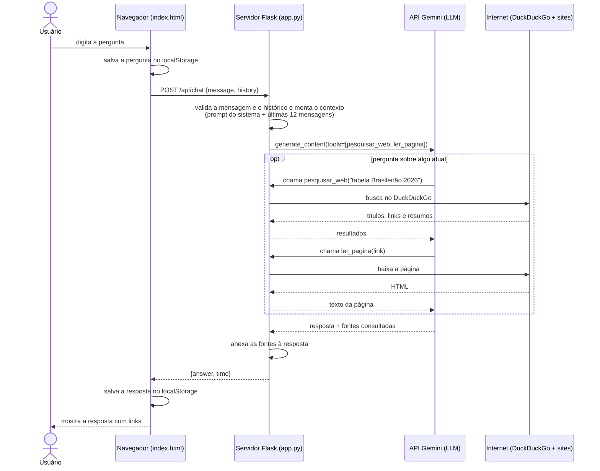

# ⚽ Boleiro — Chatbot do Brasileirão Série A

Agente conversacional em Python que responde perguntas sobre o **Campeonato Brasileiro de Futebol — Série A**. Ele conversa em português, lembra o que foi dito antes e **pesquisa na internet** quando a pergunta depende de informação atual (tabela, resultados, artilharia, próximos jogos), mostrando as fontes consultadas.

| | |
|---|---|
| **Aluno(a)** | _preencher_ |
| **Disciplina** | _preencher_ |
| **Professor(a)** | _preencher_ |
| **Data** | _preencher_ |

---

## Sumário

1. [Objetivo](#1-objetivo)
2. [Funcionalidades](#2-funcionalidades)
3. [Tecnologias utilizadas](#3-tecnologias-utilizadas)
4. [Arquitetura e funcionamento](#4-arquitetura-e-funcionamento)
5. [Estrutura de pastas](#5-estrutura-de-pastas)
6. [Como executar](#6-como-executar)
7. [Configuração (.env)](#7-configuração-env)
8. [Exemplos de uso](#8-exemplos-de-uso)
9. [Tratamento de erros](#9-tratamento-de-erros)
10. [Limitações conhecidas](#10-limitações-conhecidas)
11. [Possíveis melhorias](#11-possíveis-melhorias)

---

## 1. Objetivo

Construir um **agente de IA especializado em um domínio** (o Brasileirão Série A) que:

- receba perguntas em linguagem natural;
- gere respostas usando um modelo de linguagem (LLM);
- mantenha uma **memória da conversa**, entendendo perguntas de continuação como "e o próximo jogo dele?";
- **não invente dados**: quando a informação é atual, ele busca na web e cita as fontes.

## 2. Funcionalidades

- 💬 **Chat em tempo real**: a pergunta aparece na hora e um indicador de "digitando…" é mostrado enquanto o agente responde, sem recarregar a página.
- 🌐 **Busca na internet**: o modelo decide sozinho quando precisa pesquisar e, se preciso, abre as páginas para ler tabelas e placares. Conversa casual é respondida direto; dados atuais passam por uma pesquisa.
- 🔗 **Fontes clicáveis**: até 3 links das páginas consultadas aparecem ao final da resposta.
- 🗂️ **Gerenciador de histórico**: todas as conversas ficam salvas no `localStorage` do navegador e aparecem numa barra lateral. Veja a [seção 4.1](#41-gerenciador-de-histórico-localstorage).
- 🧠 **Memória da conversa**: as últimas 12 mensagens da conversa aberta são enviadas ao modelo como contexto, então ele entende perguntas de continuação.
- 🔄 **Modelos reserva**: se o modelo principal estiver sem cota ou sobrecarregado, o agente tenta os modelos reserva em ordem. Todos eles também pesquisam na internet.
- 💡 **Sugestões de perguntas**: uma conversa nova mostra atalhos clicáveis para começar.
- ⌨️ **Boa usabilidade**: Enter envia e Shift+Enter quebra a linha; a caixa de texto cresce conforme o texto; a conversa rola sozinha; o layout se adapta ao celular.
- 🛡️ **Validações e erros amigáveis**: mensagens vazias, limite de 4.000 caracteres, chave ausente ou inválida, modelo indisponível, limite de uso e falta de conexão.

## 3. Tecnologias utilizadas

| Camada | Tecnologia | Para que serve |
|---|---|---|
| Linguagem | **Python 3** | Lógica do servidor e integração com a IA |
| Servidor web | **Flask 3.1** | Rotas HTTP e entrega da página |
| Configuração | **python-dotenv** | Lê a chave da API e as opções do arquivo `.env` |
| IA / LLM | **Google Gemini API** (SDK `google-genai`) | Executa os modelos de linguagem do Google na nuvem |
| Modelo principal | **gemini-3.5-flash** | Gera as respostas e decide quando pesquisar |
| Modelos reserva | **gemini-3-flash-preview**, **gemini-3.5-flash-lite**, **gemini-flash-latest** | Tentados em ordem quando o principal está sem cota ou sobrecarregado |
| *Function calling* | Recurso do Gemini | Permite que o modelo chame funções Python do projeto |
| Pesquisa na web | **DuckDuckGo** (biblioteca `ddgs`) | Busca gratuita e sem chave, usada pela função `pesquisar_web` |
| Leitura de páginas | `urllib` + `html.parser` (biblioteca padrão do Python) | Baixa uma página e extrai o texto, usada pela função `ler_pagina` |
| Interface | **HTML + CSS + JavaScript** (sem frameworks) | Tela do chat, envio assíncrono com `fetch`, indicador de digitação |
| Armazenamento | **localStorage** (Web Storage API do navegador) | Guarda todas as conversas no próprio navegador |
| Fontes | **Google Fonts** (DM Sans, Barlow Condensed) | Tipografia da interface |

## 4. Arquitetura e funcionamento



### Passo a passo

1. **Interface** ([index.html](index.html)): o JavaScript salva a pergunta na conversa ativa, no `localStorage`, mostra a pergunta na tela e envia um `POST /api/chat` com `fetch`. O corpo leva a pergunta e as últimas 12 mensagens da conversa.
2. **Validação** ([app.py](app.py)): o servidor recusa mensagens vazias ou com mais de 4.000 caracteres. Ele também filtra o histórico recebido e só aceita mensagens com papel `user` ou `model`, o que impede que alguém injete instruções de sistema pelo navegador.
3. **Montagem do contexto**: o servidor junta o **prompt do sistema** (a "personalidade" e as regras do Boleiro, com a data de hoje) e as **últimas 12 mensagens** da conversa, enviadas pelo navegador.
4. **Chamada ao modelo**: a função `call_model` envia tudo para o Gemini junto com duas funções Python que ele pode chamar (*function calling*): `pesquisar_web` e `ler_pagina`, definidas em [web_tools.py](web_tools.py). O próprio modelo decide se precisa pesquisar, quais termos usar e quais páginas ler. O SDK executa as funções automaticamente, até 8 chamadas por pergunta.
5. **Pós-processamento**: cada página pesquisada ou lida é registrada, e o servidor anexa até 3 fontes à resposta, sem repetir links. As páginas lidas por completo aparecem primeiro.
6. **Resposta**: o JSON volta para o navegador, que salva a resposta na conversa de origem e mostra o texto com negrito e links clicáveis. O HTML é escapado antes de formatar, o que evita injeção de código na página.
7. **Modelos reserva**: se o Gemini retornar erro de limite (HTTP 429) ou de sobrecarga (HTTP 503), a pergunta é refeita no próximo modelo da lista.

> **Por que não usar a Pesquisa Google integrada do Gemini?** O Gemini tem uma pesquisa própria (*Google Search grounding*), mas ela não tem cota no plano gratuito. Por isso, o projeto implementa a pesquisa por conta própria. Quem tiver um plano pago pode ligar a pesquisa do Google com `GEMINI_WEB_SEARCH=google`.

### Segurança da leitura de páginas

Como é o modelo que escolhe qual link abrir, a função `ler_pagina` só aceita endereços `http`/`https` públicos. Endereços como `localhost` ou IPs da rede local são recusados, o que impede o agente de acessar serviços internos da máquina. A página baixada também é limitada em tamanho (1,5 MB), e só os primeiros 8.000 caracteres do texto vão para o modelo.

### 4.1 Gerenciador de histórico (localStorage)

O servidor **não guarda nenhuma conversa**. Todo o histórico fica no `localStorage` do navegador, em duas chaves:

| Chave | Conteúdo |
|---|---|
| `boleiro.conversas` | Lista de conversas em JSON |
| `boleiro.conversaAtiva` | `id` da conversa aberta, para reabri-la ao recarregar a página |

Formato de cada conversa:

```json
{
  "id": "3f1c…",
  "title": "Quem lidera o Brasileirão?",
  "createdAt": 1790000000000,
  "updatedAt": 1790000300000,
  "messages": [
    { "role": "user",  "text": "Quem lidera o Brasileirão?", "time": "12:40" },
    { "role": "model", "text": "O Flamengo lidera com 60 pontos…", "time": "12:40" }
  ]
}
```

**Funcionalidades do gerenciador:**

| Função | Como funciona |
|---|---|
| **Nova conversa** | Abre uma tela limpa com sugestões. A conversa só é salva quando a primeira mensagem é enviada, então não sobram conversas vazias na lista. |
| **Título automático** | O título é a primeira pergunta, cortada em 42 caracteres. |
| **Lista agrupada por data** | Hoje, Ontem, Últimos 7 dias, Últimos 30 dias e Mais antigas, das mais recentes para as mais antigas. Mostra data, hora e quantidade de mensagens. |
| **Abrir conversa** | Clique na lista para continuar de onde parou. O modelo recebe o contexto daquela conversa. |
| **Renomear** (✎) | Edita o título na própria lista. Enter salva e Esc cancela. |
| **Excluir** (🗑) | Remove uma conversa, depois de uma confirmação. |
| **Buscar** | Filtra as conversas pelo título **e** pelo conteúdo das mensagens. |
| **Exportar** | Baixa todas as conversas num arquivo `boleiro-conversas-AAAA-MM-DD.json`. |
| **Importar** | Carrega um arquivo exportado. Conversas repetidas (mesmo `id`) são ignoradas e dados inválidos são descartados. |
| **Apagar tudo** | Remove todas as conversas, depois de uma confirmação. |
| **Persistência** | Ao recarregar a página ou reabrir o navegador, as conversas e a conversa ativa voltam. |
| **Troca durante a resposta** | Se o usuário trocar de conversa enquanto o agente responde, a resposta é salva na conversa certa. |
| **Várias abas** | Uma conversa criada em outra aba aparece automaticamente nesta (evento `storage`). |
| **Celular** | A barra lateral vira um menu deslizante, aberto pelo botão ☰. |

**Erros:** avisos de erro, como falta de conexão, ficam salvos na conversa, marcados com `error: true`, mas não são enviados ao modelo como contexto. Se o `localStorage` estiver cheio ou bloqueado (por exemplo, em uma janela anônima com restrições), o chat continua funcionando e mostra um aviso.

### Engenharia de prompt

O prompt do sistema define que o agente:

- é especialista no Brasileirão Série A e responde em português brasileiro;
- deve **diferenciar fatos, opiniões e previsões** e **nunca inventar** resultados ou números;
- **deve pesquisar** antes de responder sobre tabela, rodadas, resultados, artilharia, elencos, técnicos, transferências e notícias;
- sabe a data atual, para interpretar "agora", "última rodada" e "próximo jogo";
- usa listas em vez de tabelas, para a resposta ficar legível no chat.

### Rotas da aplicação

| Método | Rota | Descrição |
|---|---|---|
| `GET` | `/` | Abre a página do chat |
| `POST` | `/api/chat` | Recebe `{ "message": "...", "history": [{ "role", "text" }] }` e devolve `{ "answer", "time" }` ou `{ "error" }` |

## 5. Estrutura de pastas

```
chatbot-brasileirao/
├── app.py            # Servidor Flask: rotas, prompt, chamada ao Gemini e erros
├── web_tools.py      # Funções que o Gemini chama: pesquisar_web e ler_pagina
├── index.html        # Interface do chat e gerenciador de histórico (HTML + JavaScript)
├── static/
│   └── style.css     # Estilo visual (tema escuro, responsivo)
├── requirements.txt  # Dependências Python
├── .env.example      # Modelo do arquivo de configuração
├── .env              # Configuração real com a chave da API (não vai para o Git)
└── .gitignore        # Ignora .env, .venv e __pycache__
```

## 6. Como executar

### Pré-requisitos

- **Python 3.10 ou superior**
- Uma **chave gratuita da API Gemini**, criada no Google AI Studio: https://aistudio.google.com/apikey

### 1) Criar o ambiente virtual e instalar as dependências

**macOS / Linux**

```bash
cd chatbot-brasileirao
python3 -m venv .venv
source .venv/bin/activate
pip install -r requirements.txt
```

**Windows (PowerShell)**

```powershell
cd chatbot-brasileirao
python -m venv .venv
.\.venv\Scripts\Activate.ps1
pip install -r requirements.txt
```

### 2) Configurar a chave

Copie o arquivo de exemplo e cole sua chave em `GEMINI_API_KEY`:

```bash
cp .env.example .env        # Windows: copy .env.example .env
```

### 3) Iniciar o servidor

```bash
python app.py
```

Acesse **http://127.0.0.1:5000** no navegador.

> **No macOS**, a porta 5000 costuma estar ocupada pelo *Receptor AirPlay*. Nesse caso, use outra porta:
>
> ```bash
> PORT=5001 python app.py
> ```
>
> e acesse **http://127.0.0.1:5001**.

## 7. Configuração (.env)

| Variável | Obrigatória | Padrão | Descrição |
|---|---|---|---|
| `GEMINI_API_KEY` | ✅ | — | Chave da API Gemini |
| `GEMINI_MODEL` | | `gemini-3.5-flash` | Modelo principal |
| `GEMINI_FALLBACK_MODELS` | | `gemini-3-flash-preview,gemini-3.5-flash-lite,gemini-flash-latest` | Modelos reserva, separados por vírgula e tentados em ordem |
| `GEMINI_WEB_SEARCH` | | `duckduckgo` | Como o agente acessa a internet: `duckduckgo` (gratuito), `google` (exige plano pago) ou `off` |
| `PORT` | | `5000` | Porta do servidor |

## 8. Exemplos de uso

Perguntas de exemplo e como o agente se comporta:

| Pergunta | Comportamento |
|---|---|
| "Oi!" | Responde direto, sem pesquisar (~1s) |
| "Me passa os 5 primeiros da tabela com pontos" | Pesquisa na web e lista posição, clube e pontos, com links da CBF, ge e Lance |
| "E quando é o próximo jogo do líder?" | Usa a memória para saber quem é o líder, pesquisa e informa data, horário e estádio |
| "Quem é o artilheiro?" | Pesquisa e informa o jogador, o clube e o número de gols |
| "Quem foi o campeão de 2025?" | Pesquisa, porque a informação é posterior ao treinamento do modelo |

Outras perguntas para testar:

- "Qual foi o resultado do último jogo do Palmeiras?"
- "Quem está na zona de rebaixamento?"
- "Compare a campanha do Flamengo e do Palmeiras neste ano."
- "Como funciona o regulamento do Brasileirão?"

## 9. Tratamento de erros

| Situação | O que o usuário vê |
|---|---|
| Mensagem vazia | "Escreva uma mensagem antes de enviar." |
| Mais de 4.000 caracteres | Aviso de limite de tamanho |
| Chave ausente | "Configure a GEMINI_API_KEY no arquivo .env." |
| Chave inválida | "A chave do Gemini é inválida ou sem permissão…" |
| Modelo inexistente | "O modelo '…' não está disponível no Gemini…" |
| Limite de uso ou sobrecarga | Tenta os modelos reserva; se todos falharem, mostra um aviso para tentar mais tarde |
| Demora excessiva | "O Gemini está sobrecarregado ou demorando…" |
| Servidor desligado | "Sem conexão com o servidor…" |

As mensagens de erro aparecem em vermelho no chat, e os detalhes técnicos ficam registrados no log do servidor.

## 10. Limitações conhecidas

- **Plano gratuito do Gemini**: há um número máximo de perguntas por minuto e por dia, e em horários de pico os modelos ficam sobrecarregados (erro 503). Os modelos reserva reduzem o problema, mas não o eliminam.
- **Pesquisa pelo DuckDuckGo**: é gratuita, mas pode trazer resultados menos precisos que o Google. Alguns sites bloqueiam a leitura automática ou montam a tabela com JavaScript; nesses casos, o agente tenta outra fonte.
- **Tempo de resposta**: perguntas que exigem várias buscas e leituras de páginas podem levar de 20 segundos a quase 2 minutos.
- **Qualidade das fontes**: o agente depende dos sites encontrados na busca. Datas e placares devem ser conferidos nos links informados.
- **Histórico local**: as conversas ficam só no navegador em que foram feitas. Outro navegador ou computador não as vê (use Exportar/Importar para levá-las), e limpar os dados do site apaga o histórico. O `localStorage` tem limite de cerca de 5 MB.
- **Servidor de desenvolvimento**: o `app.run(debug=True)` serve para uso local e não para produção.

## 11. Possíveis melhorias

- Respostas em *streaming*, com o texto aparecendo aos poucos.
- Integração com uma API de futebol para obter tabela e resultados oficiais, sem depender de busca.
- Banco de dados e login, para sincronizar as conversas entre dispositivos.
- Testes automatizados com `pytest`.
- Publicação em um servidor com Gunicorn ou em uma plataforma como Render ou Railway.
# chatbot

